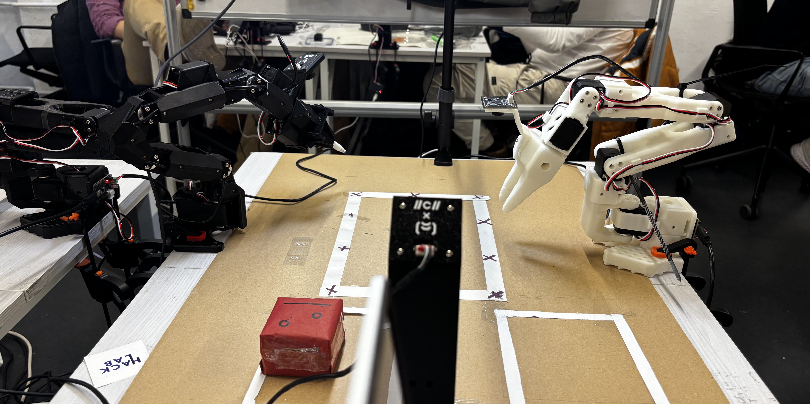
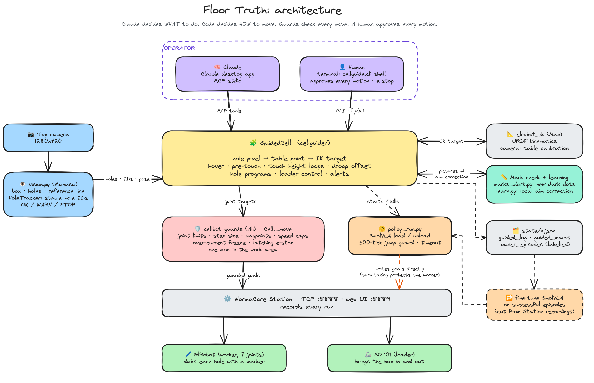
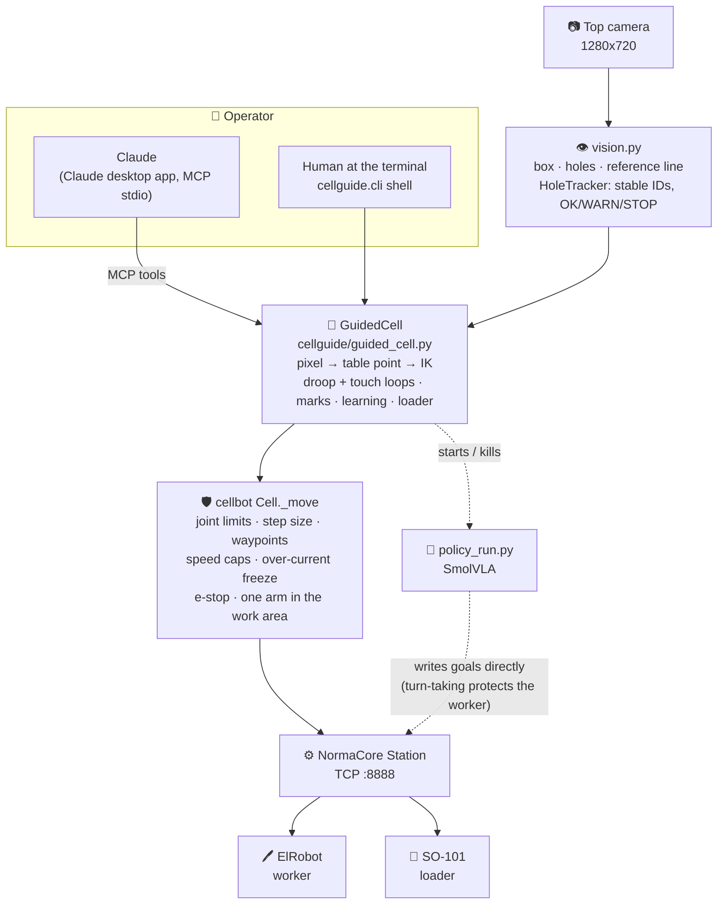
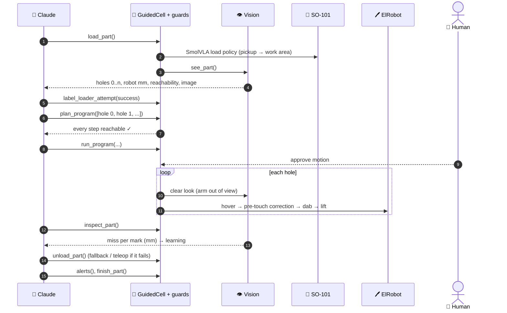
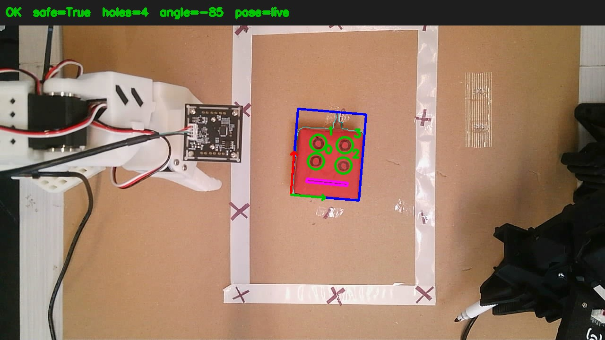
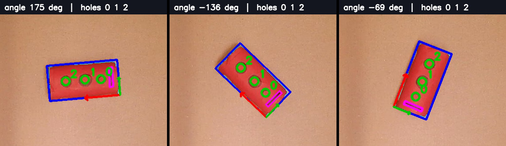
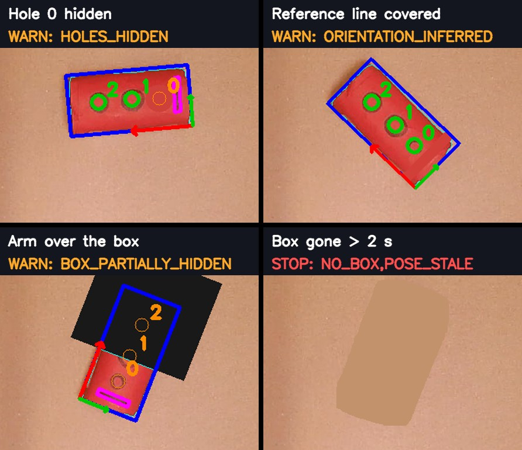
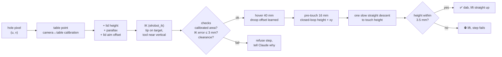
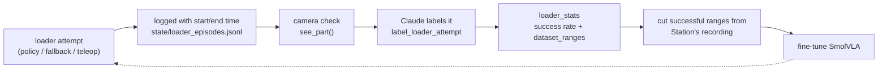

<div align="center">

# 🤖 Guided Cell

### Claude runs a two-arm robot cell, guided by the cameras

**HackLab x BRISA Berlin Robotics & AI Hackathon (21-22 Nov 2026) · NormaCore track: AI-powered robot control**




<sub>The real cell at the hackathon. ElRobot worker holding the marker (left) · SO-101 loader (right) · top-camera mount (centre) · red box with drawn holes on the taped table.</sub>

</div>

---

## ✨ What it does

A red box arrives with holes drawn on its lid. The cell has to **find every hole and dab it with a marker**,
wherever the box lands and however it is rotated.

| | Who | Does what |
|---|---|---|
| 🦾 | **SO-101** (loader / "holder") | Brings the box into the work area and takes it out: trained **SmolVLA** policy, taught poses, or a human |
| 👁️ | **Top camera + vision** | Finds the box, the holes and a reference line; gives every hole a **stable ID** at any angle |
| 🖊️ | **ElRobot** (worker, 7 joints) | Dabs each hole. Targets come from **camera → calibration → inverse kinematics**, not taught poses |
| 📏 | **Mark check + learning** | Measures where each dot landed and learns an aim correction from the misses |
| 🧠 | **Claude** (via MCP) | Decides **what** to do: which holes, in what order, what to do after a failure. Code decides **how** to move |
| 🛡️ | **Guards + human** | Every command passes a safety layer; a human approves every motion |

## 🔗 Platform links

| | |
|---|---|
| **NormaCore Station** (the robot API this cell talks to) | <https://github.com/norma-core/norma-core/tree/main/software/station/bin/station> |
| **ElRobot** (the 7-joint worker arm) | <https://github.com/norma-core/norma-core/tree/main/hardware/elrobot> |
| **norma-core** (full repo: Station, drivers, SmolVLA tooling) | <https://github.com/norma-core/norma-core> |

---

## 📑 Contents

1. [Architecture](#-architecture)
2. [One cycle, step by step](#-one-cycle-step-by-step)
3. [How the robot sees](#-how-the-robot-sees)
4. [From a pixel to a dab](#-from-a-pixel-to-a-dab)
5. [Loader and the data flywheel](#-loader-and-the-data-flywheel)
6. [Repository structure](#-repository-structure)
7. [Getting started](#-getting-started)
8. [Interfaces: MCP tools and CLI](#-interfaces-mcp-tools-and-cli)
9. [Configuration](#-configuration)
10. [Safety model](#-safety-model)
11. [Project status and results](#-project-status-and-results)
12. [Team](#-team)
13. [Documentation index](#-documentation-index)
14. [Demo video and presentation](#-demo-video-and-presentation)

---

## 🏗 Architecture

<p align="center">
<br>
<sub>Editable source: <a href="docs/architecture.excalidraw"><code>docs/architecture.excalidraw</code></a> (open it at excalidraw.com).</sub>
</p>

The same flow as a Mermaid diagram:



The cell combines three code drops without modifying them:
- **cellbot** (Ali): guards, Station I/O, MCP server.
- **vision.py** (Manasa): box and hole detection, tracker.
- **elrobot_ik** (Max): kinematics and calibration.

The SO-101 loader runs two **SmolVLA** policies, one for load and one for unload, trained on demonstration data
collected by **Sai Akash**.

The new integration package is `cellguide/`.

---

## 🔁 One cycle, step by step



---

## 👀 How the robot sees

The vision is a **classical OpenCV pipeline**, so there's no training data or GPU.

1. **Find the box.** Segment the red face in HSV. A face only counts if it is solid, compact and has holes, so a
   red servo wire is rejected.
2. **Find the markings.** Inside the face, keep pixels darker than their local surroundings in the brightness
   channel. **Round** blobs are holes (filled or hollow drawn circles); a **long thin** blob is the reference line.
3. **Pose and IDs.** The box outline gives the position and angle. The reference line marks the "front", so holes
   are numbered the same way at any rotation.

<p align="center">
<br>
<sub>Detection on the real setup picture: box outline (blue), holes with IDs (green), reference line (magenta), box axes, status banner.</sub>
</p>

<p align="center">
<br>
<sub>Same box, three rotations (real frames): hole 0 is always the hole next to the reference line.</sub>
</p>

### Tracking through interruptions

`HoleTracker` saves the hole layout after 3 clear frames and matches every later frame against it:
- hidden holes keep their IDs;
- a covered line is worked out from earlier frames;
- the last pose is held for up to 2 s while the arm covers the box;
- after that it reports **STOP** rather than guess.

<p align="center">
<br>
<sub>Tracker output on real frames with <b>simulated</b> occlusions (painted in by <code>test_vision.py</code>-style helpers). Orange = predicted position of a hidden hole.</sub>
</p>

| Vision source (`[vision] source`) | What it does |
|---|---|
| `camera:auto` / `camera:N` ⭐ | Opens the camera in-process and runs detection on every frame. `auto` picks the camera that looks like `top_ref.jpg`, because macOS renumbers cameras. A live viewer is served at `http://<host>:8765/frame.jpg` |
| `http://host:8765` | Reads Manasa's standalone vision server |
| `station:…` | Station frames. Refused: Station resizes them to 224 px, which doesn't match the 1280x720 calibration |

---

## 🎯 From a pixel to a dab



- **One clear look.** The arm hides the lid while it works, so it takes one clear look from `home` / `look` and
  works from it (`sees_under_arm = false`). If the box moves, it looks again: `run --look` looks before every hole.
- **Droop correction.** Under gravity the ElRobot shoulder sags about 4°. Every goal is sent as `q + offset`, with
  the offset learned from joint feedback.
- **Mark check.** The tool is a **black marker**, the same colour as the drawn rings. So `marks_dark.py` aligns a
  *before* and *after* picture in the part's frame and keeps only **new** dark dots. Each dot gives a miss in mm.
- **Learning.** `learn.py` keeps a **local** correction per lid position. It learns the arm's own error, not the
  raw miss, so repeated runs converge instead of winding up. Marks from a box that slid are excluded.

---

## 🦾 Loader and the data flywheel

| Mode | How the SO-101 moves | Guards |
|---|---|---|
| `policy` | **SmolVLA** checkpoint run by `policy_run.py`: chunked playback, a 300-tick jump guard, stops when still | Outside cellbot. The SO-101 zone stays `unknown` until `go_home`, so the worker cannot move; the process is killed on timeout or e-stop |
| `taught` | Taught sequences, e.g. sweep → grasp → lift → carry → release | All cellbot guards |
| fallback | Taught pre-grasp, then the policy (`unload_part(variant="fallback")`) | Guards for the taught part |
| teleop | A human drives the SO-101 with the leader arm through Station teleoperation; the cell moves nothing | — |
| `human` | A person places or removes the box; the camera verifies | — |



**The policies.** Two SmolVLA policies, one for load and one for unload, for the SO-101's 6-D action and state:
- vision–language model `HuggingFaceTB/SmolVLM2-500M-Video-Instruct` with a frozen vision encoder; only the action
  expert is trained;
- chunk size 50, 2 cameras, 10 denoising steps;
- checkpoints at steps 5,000 and 10,000, plus `final`.

These details come from `policies/*/final/config.json`. The weights (about 1.2 GB each) and training logs are not
committed.

---

## 📁 Repository structure

```
norma-hackathon/
├── README.md                     ← you are here
├── docs/images/                  pictures used in this README (made with the repo's own vision code)
└── guided_cell/
    ├── README.md                 detailed setup on the Mac, tools, guard keys, droop/touch loop, known gaps
    ├── TESTING.md                stage-by-stage bring-up (0 install → 8 Claude as operator)
    ├── POLICY.md                 SmolVLA loader policies, hybrid / sweep / fallback unload, loader flywheel
    ├── CLAUDE.md                 how Claude narrates a run (STEP / DECISION / LOADER / RECORDING lines)
    ├── VIDEO_FACTS.md            verified fact sheet for the demo video (22 Nov, 09:50)
    ├── guided.toml               ⚙️ main config: paths, vision, tool, part, motion, loader, marks
    ├── cell.guided.toml          ⚙️ cellbot config for this cell (Station host, norma-core path, guards)
    ├── setup_mac.sh              .venv + deps + offline tests + Claude desktop config block
    ├── top_ref.jpg               reference top view (used by camera:auto)
    │
    ├── cellguide/                🧩 integration package (new code)
    │   ├── guided_cell.py        GuidedCell(cellbot.Cell): camera-guided aiming, hover/touch, droop, programs
    │   ├── kin.py                pixel → part point → ElRobot joint target (elrobot_ik)
    │   ├── vision_source.py      HttpVision / FrameVision / CameraVision, camera:auto selector
    │   ├── loader.py             SO-101 load/unload: taught · policy · human · teleop; episode log + labels
    │   ├── marks_dark.py         new-dark-dot detection by before/after image alignment
    │   ├── learn.py              local aim-correction model (data flywheel)
    │   ├── alerts.py             operator feed + recommendation (continue / check / pause)
    │   ├── server.py             MCP server = cellbot tools + guided tools
    │   ├── cli.py                terminal shell with the same functions
    │   ├── preflight.py          read-only readiness checklist
    │   ├── operator_prompt.py    `run_guided` operator procedure
    │   ├── teach_tool.py         pen-tip calibration from joint readings (never moves)
    │   └── config.py             loads guided.toml, imports the vendored drops in place
    │
    ├── policy_run.py             🤗 chunked SmolVLA runner for the SO-101
    ├── unload_hybrid.py          taught approach + SmolVLA unload
    ├── policies/{load,unload}/{step-005000,step-010000,final}/config.json
    ├── state/                    taught poses (station + sim), lid aim offset, hybrid poses
    ├── demo/                     run-report + evidence-pack generators, 2 real run reports (HTML)
    ├── tests/                    16 offline test scripts (simulator + recorded frames)
    └── third_party/              vendored, NOT modified
        ├── cellbot/              (Ali) guarded Cell, Station backend, simulator, e-stop, teach, MCP server
        └── vision/               (Manasa) vision.py, calibration + capture tools, test frames
```

<details>
<summary><b>External dependencies (not in this repo)</b></summary>

| Dependency | Why | Expected at |
|---|---|---|
| [**norma-core**](https://github.com/norma-core/norma-core) / [**Station**](https://github.com/norma-core/norma-core/tree/main/software/station/bin/station) | Runs the arm buses (TCP :8888, web UI :8889). cellbot imports its `station_py` client; the SmolVLA env lives in `software/ai/smolvla_py` | `cell.guided.toml [station] norma_core_dir`, `guided.toml [loader] policy_cwd` |
| **`elrobot_ik`** (Max) | URDF kinematics, `joint_map.json`, `table_calib.json`, `aim.json`, `tool_offset.json` | `../elrobot_ik`, a sibling of `guided_cell/` |
| **Hardware** | [ElRobot](https://github.com/norma-core/norma-core/tree/main/hardware/elrobot) follower, SO-101 follower, top camera at 1280x720, Station cameras for the policy | Bus serials in `guided.toml` / `POLICY.md` |
| **Claude desktop app** | Claude as operator over MCP | Block printed by `setup_mac.sh` |
| **Python ≥ 3.10** | `anthropic[mcp]`, `mcp`, `numpy`, `pillow`, `opencv-python-headless`, `scipy` | `guided_cell/.venv` |
| **SmolVLA weights** | `model.safetensors` per checkpoint (~1.2 GB, not committed) | `policies/{load,unload}/final/` |

> ⚠️ `guided.toml`, `cell.guided.toml` and `POLICY.md` contain absolute paths of the team Mac (`/Users/MXH37/...`).
> Change them on another machine.

</details>

---

## 🚀 Getting started

```bash
cd guided_cell
bash setup_mac.sh            # .venv + deps + 7 core offline tests (must PASS) + Claude config block

G=$(pwd)
export CELLBOT_CONFIG=$G/cell.guided.toml CELLBOT_STATE=$G/state PYTHONPATH=$G
PY=$G/.venv/bin/python
```

**🧪 Simulator, no hardware.** Recorded camera frames instead of the camera:
```bash
env CELLBOT_MODE=sim $PY -m cellguide.cli --frames "$G/third_party/vision/images" shell
#   new · see · plan all · run 0 2 1 · inspect · alerts · quit
```

**🦾 Real cell.** Station running with `--web --tcp`, all teleop off:
```bash
env CELLBOT_MODE=station STATION_HOST=127.0.0.1 $PY -m cellguide.preflight   # must say READY
env CELLBOT_MODE=station STATION_HOST=127.0.0.1 $PY -m cellguide.cli shell
#   home so101 · home elrobot · new · see · plan all · run 0 1 2 · inspect · alerts
#   every motion asks "Move the real arm? [y/N]" · Ctrl+C = emergency stop
```

**🧠 Claude as operator.** Paste the `"cellguide"` block from `setup_mac.sh` under `"mcpServers"` in
`claude_desktop_config.json`. Restart Claude and ask *"run the guided procedure for 1 part"*. Approve each motion.
Never run the CLI shell at the same time.

**🧪 Tests.** Every `tests/test_*.py` is a standalone script (`$PY tests/test_guided_sim.py`). `setup_mac.sh` runs
the 7 core ones.
**🤗 Policies.** Follow [`guided_cell/POLICY.md`](guided_cell/POLICY.md) and start with `policy_run.py --dry-run`.
Full bring-up: [`guided_cell/TESTING.md`](guided_cell/TESTING.md).

---

## 🧰 Interfaces: MCP tools and CLI

<details open>
<summary><b>Guided MCP tools</b> (<code>cellguide/server.py</code>)</summary>

| Tool | What it does |
|---|---|
| `new_part` · `see_part` | Lock a new part's hole layout · holes, IDs, robot mm, reachability and the annotated image |
| `plan_program` · `run_program` | Check (no motion) · run a hole program from one clear look (`look_each_step` re-looks before every step) |
| `inspect_part` · `retreat` · `guided_status` | Measure marks and feed learning · lift and go to the look pose · set-up, droop, learning, guards |
| `load_part(variant)` · `unload_part(variant)` · `finish_teleop` | Loader phases: `primary`, `fallback`, `teleop` |
| `label_loader_attempt` · `loader_stats` | Loader flywheel: labels, success rates, dataset time ranges |
| `alerts` · `preflight` | Operator feed with a recommendation · readiness checklist |

Also: prompt `run_guided(parts)` and resource `cellguide://procedure`. All **cellbot** tools stay available
(`get_status`, `look`, `go_home`, `go_to_pose`, `move_joints`, `gripper`, `finish_part`, `stop`, ...). Claude can
latch the e-stop but **cannot release it**.

</details>

<details>
<summary><b>CLI commands</b> (<code>python -m cellguide.cli shell</code>, then <code>help</code>)</summary>

`status` · `preflight` · `guided` · `see` · `new` · `plan <steps>` · `run [--look] <steps>` · `hover <id>` ·
`touch <id>` · `inspect` · `retreat` · `home <arm>` · `gripper <arm> open|close` · `load` / `unload [fallback|teleop]` ·
`teleop done` · `label ok|fail` · `loader` · `jog` (teach the lid aim offset) · `aim` · `droop` ·
`set <key> <value>` (session only) · `alerts` · `finish` · `stop` · `look`

Program short form: `run 0 2 1` (dab holes 0, 2, 1) · `h0` (hover over hole 0) · `0.5,0.2` (a point on the lid) ·
`all`.

</details>

---

## 🔧 Configuration

<details>
<summary><b><code>guided_cell/guided.toml</code></b>: section by section</summary>

| Section | Key settings |
|---|---|
| `[paths]` | `cellbot_dir`, `elrobot_ik_dir`, `vision_file`, `calib_file`, `aim_file` |
| `[vision]` | `source`, `top_reference`, `width`/`height` (1280x720), `view_port` 8765, `max_state_age_s`, `sees_under_arm` |
| `[tool]` | `tip_local_m` (marker tip in the gripper frame), `close_gripper` |
| `[part]` | `surface_height_mm`, `camera_height_mm`, `camera_nadir_px` (parallax) |
| `[motion]` | `hover_mm`, `high_mm`, `clearance_mm`, `touch_mm`, `dwell_s`, `ik_tol_mm`, `workspace_margin_mm`, `settle_*` (droop), `pretouch_*` / `touch_*` (height loop), `look_pose`, `all_slow` |
| `[loader]` | `mode` / `load_mode` / `unload_mode`, `policy_*_cmd`, `policy_*_task`, `policy_timeout_s`, pre-poses, pre-sequences, fallbacks, `taught_*_seq` |
| `[marks]` | `method` (`diff` = black marker, `color` = blue ink), alignment limits, `tolerance_mm`, learning (`gain`, `max_correction_mm`, `window`, `local_scale_mm`, `outlier_mm`) |

Some inline comments describe older test values. For example, the `touch_mm` comment says "stops 10 mm above" but
the value is `2.0`, and the `dwell_s` comment says "stays down 6 s" but the value is `1.5`. Trust the values.

As shipped, `[loader]` loads with the SmolVLA policy (`mode = "policy"`) but unloads with a taught sweep
(`unload_mode = "taught"`). Set `unload_mode = ""` to unload with the policy as well.

</details>

<details>
<summary><b><code>cell.guided.toml</code> and environment variables</b></summary>

`cell.guided.toml` is a copy of cellbot's `cell.toml`, used through `CELLBOT_CONFIG`. Only three things differ:
- `[station] host`;
- `norma_core_dir`;
- `reach_tolerance` (0.02 → 0.04, because of the shoulder droop).

`tests/test_config_copy.py` checks every other guard value.

| Variable | Meaning |
|---|---|
| `CELLBOT_CONFIG` | Path to `cell.guided.toml` |
| `CELLBOT_STATE` | Path to `guided_cell/state` |
| `PYTHONPATH` | Path to `guided_cell` |
| `CELLBOT_MODE` | `sim` or `station` |
| `STATION_HOST` | e.g. `127.0.0.1` |

</details>

---

## 🔒 Safety model

| Layer | What it enforces |
|---|---|
| **cellbot guards** (every guided and taught move) | Joint limits (targets out of range are refused, never clamped) · maximum step per joint command (taught poses exempt) · waypoints · speed caps · over-current freeze of both arms · move timeout · latching e-stop · one arm in the work area |
| **cellguide checks** | Target inside the calibrated area · IK error ≤ `ik_tol_mm` · tip clearance · pre-touch and touch height loops with sag abort · fresh Station data · vision lock (`safe_to_act`) |
| **Human in the loop** | Every motion approved (`[y/N]` in the CLI, tool approval in the Claude app) · only humans teach poses and release the e-stop · Ctrl+C = emergency stop |
| **Policy mode** | Bypasses cellbot. Protected by turn-taking, the runner's jump guard, a timeout and the e-stop kill |

> ⚠️ **Vision is not a safety system.** There is no hand or object detector; a hand only stops motion because it
> breaks the box detection. Keep a person at the power switch.

<details>
<summary><b>Logs written at run time</b> (<code>state/</code>, not committed)</summary>

| File | Content |
|---|---|
| `events.jsonl` | Moves, refusals, e-stop, part start and finish |
| `guided_log.jsonl` | Per guided step: aimed point, joints commanded and reached, touch errors, correction, timing |
| `guided_marks.jsonl` | Measured misses per hole, kept or excluded |
| `loader_episodes.jsonl` | Loader attempts: phase, variant, start and end time, exit code, label |
| `cli/*.jpg`, `marks/*` | Annotated images; before / after / diff images of mark inspection |

`demo/make_pack.py` and `demo/make_run_page.py` turn these into reports.

</details>

---

## 📊 Project status and results

Sources: the two generated run reports in [`guided_cell/demo/`](guided_cell/demo) (22 Nov 2026, afternoon) and
[`VIDEO_FACTS.md`](guided_cell/VIDEO_FACTS.md) (09:50 the same day). The raw JSONL logs are not in this repo.

**✅ Shown on the real arms**

- **Camera-guided dabbing by the ElRobot.** On part `84dbf0`, holes 0, 1 and 3 were dabbed with touch-height
  errors of +0.5, +1.3 and +1.4 mm. Hole 2 was refused by the height guard (+3.6 mm > 3.5 mm), and the arm lifted
  without touching.
- **Policy load by the SO-101.** 5 of 6 load attempts during the day were camera-labelled success (74-109 s
  each). The sixth was safety-stopped by the policy runner's jump guard (shoulder_pan jump of 645 ticks > 300).
- **Claude as operator with guards active.** Recorded examples:
  - a hand on the box → e-stop latched, human released it;
  - the worker was refused while the SO-101 position was unknown;
  - every policy loader attempt got a camera label;
  - after the primary unload failed, Claude ran the fallback.
- **Measured marks.** The day's chart lists 12 measured marks with misses from **0.4 to 18.1 mm**.

**🚧 Not working yet**

- **Unload policy.** Failed 2 of 2 times (primary and fallback) on part `84dbf0`. On part `296687` a human
  unloaded the box by hand.
- **Aim accuracy.** Not reliably within the 3 mm tolerance yet. The box slides when touched.
- **Following a moving part while working.** Not available with the top camera alone. The wrist camera is not
  used yet.
- **Hand / object detection.** None. Logging into Station/NormFS itself is not done either; logs are JSONL files.

---

## 👥 Team

| Member | Built |
|---|---|
| **Max** | ElRobot kinematics and calibration (`elrobot_ik`, external) · integration package `cellguide/`, policy runner, demo tools (commit author) |
| **Ali** | `cellbot`: guarded cell, Station backend, simulator, e-stop, teach tool, MCP server, Claude orchestrator |
| **Manasa** | Computer vision: `vision.py`, hole tracker, HTTP server, calibration and capture tools |
| **Sai Akash** | Collected the SO-101 demonstration data used to train the SmolVLA load and unload policies |

---

## 📚 Documentation index

| Document | Read it for |
|---|---|
| 📘 [`guided_cell/README.md`](guided_cell/README.md) | Detailed setup on the Mac, vision sources, all tools, guard keys, droop and touch loop, known gaps |
| 🧪 [`guided_cell/TESTING.md`](guided_cell/TESTING.md) | Step-by-step bring-up from install to Claude as operator |
| 🤗 [`guided_cell/POLICY.md`](guided_cell/POLICY.md) | Running and tuning the SmolVLA loader, hybrid and sweep unload, loader flywheel |
| 🧠 [`guided_cell/CLAUDE.md`](guided_cell/CLAUDE.md) | How Claude narrates a run |
| 🎬 [`guided_cell/VIDEO_FACTS.md`](guided_cell/VIDEO_FACTS.md) | Verified fact sheet for the demo video |
| 🛡️ [`third_party/cellbot/README.md`](guided_cell/third_party/cellbot/README.md) | cellbot design: guardrails, MCP server, simulator, orchestrator |
| 👁️ [`third_party/vision/README.md`](guided_cell/third_party/vision/README.md) | Vision integration guide: `/state` format, events, calibration |
| 📄 `guided_cell/demo/run_report_*.html` | Step-by-step reports of two real runs (open in a browser) |
| 🔗 [NormaCore Station](https://github.com/norma-core/norma-core/tree/main/software/station/bin/station) · [ElRobot](https://github.com/norma-core/norma-core/tree/main/hardware/elrobot) | Upstream platform |

---

## 🎬 Demo video and presentation

| | Link |
|---|---|
| ▶️ **Demo video (YouTube)** | <!-- TODO: replace with the YouTube link --> [Watch on YouTube](https://www.youtube.com/watch?v=VIDEO_ID) |
| 📊 **Presentation (PPT)** | <!-- TODO: replace with the slides link or add the file, e.g. docs/presentation.pptx --> [Open the slides](docs/presentation.pptx) |
